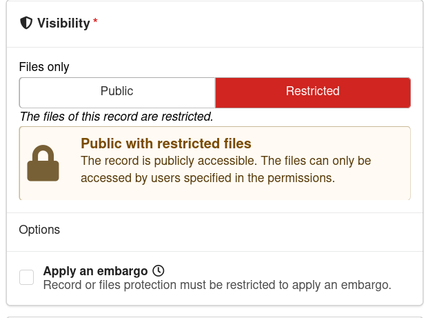
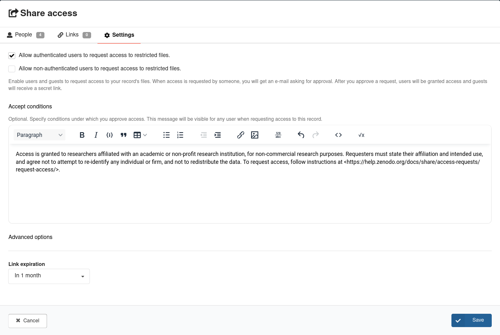
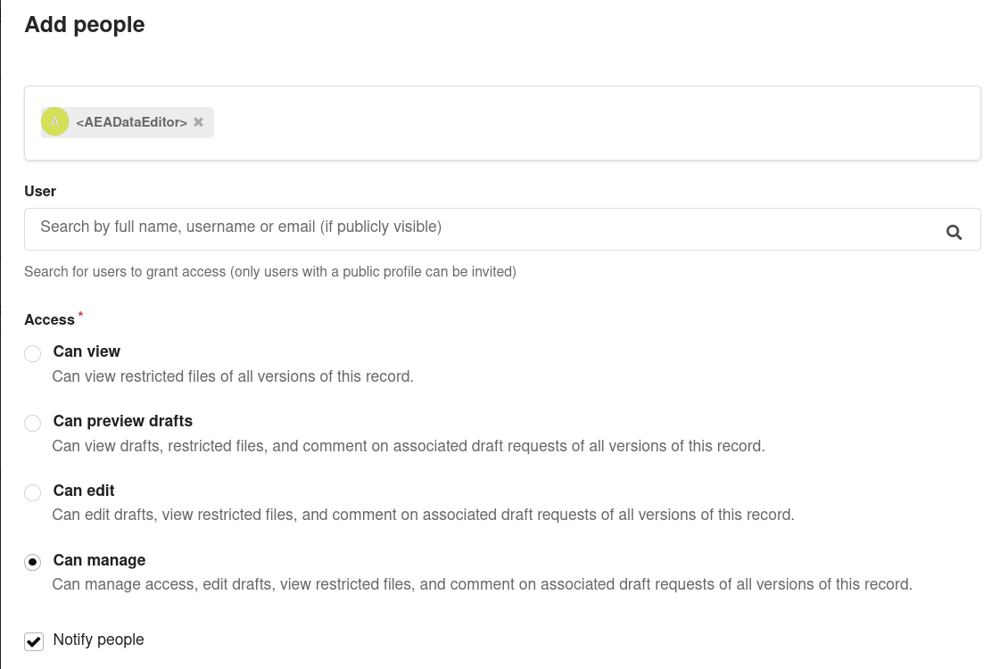

Sometimes, authors have data that they are allowed to share, but **not openly/without restrictions**. 

This post describes one solution: a **restricted, but shareable** supplementary deposit, which is linked to the main replication package. I will use openICPSR (the AEA main repository) and Zenodo (for the supplement) but similar methods can be used within a single repository, or across different pairs of repositories (though details will be different).

<!-- more -->

## When is this the right solution?

The data use agreement may say that the data can be given to other researchers who agree to certain conditions, but not posted for anybody to download. Or the data may contain information that is too sensitive for an open deposit, but not so sensitive that it needs to sit in a secure enclave. 

Most repositories only allow for deposit-wide permissions: Either all the files are restricted, or none of them are. So restricting the deposit because one data file is restricted would make the code, and documentation, inaccessible to others.[^exceptions]

[^exceptions]: Some repositories, like Dataverse, allow for file-level restrictions within a single deposit.

Restricted but shareable data thus cannot go into the primary replication package. But the data should also not just sit on the author's laptop either. Here I describe how to proceed. In earlier posts, I described what to do with [data from unnamed providers](2026-05-08-private-data) and with [data containing PII](2026-05-05-pii) that were obtained under additional permissions (IRB, data use agreements), for which this is typically not appropriate. A very similar scenario with a specific data provider was described [in the case of the PSID](2024-11-01-psid-requests). The instructions here expand on [my guidance page](https://aeadataeditor.github.io/aea-de-guidance/creating-restricted-data-deposit-icpsr), with much more detail. 

A restricted deposit, in this example on Zenodo, fits a specific case in between:

- the **author** has the right to redistribute the data, but only under conditions (e.g., "for non-commercial research only", "users must agree not to re-identify respondents", "users must cite the original source");
- no additional conditions (e.g., by IRB or data provider) have been imposed. 

Note that the presence of PII does not, by itself, rule out this solution. For instance, data obtained through **public records requests** may not have redistribution restrictions, and (implicitly or explicitly) be in the public domain. But *combining* several such sources may produce files with sensitive identifiable information on private citizens. Authors (or the repository) may then reasonably decide that an open deposit is not appropriate, even though nothing legally prevents it. A restricted deposit, with generous access conditions, fits such cases well. See the [example](#an-example) below.

It is **not** the right solution when:

- the data are licensed from a third party that does not allow redistribution at all (then the data are not yours to deposit; document how to obtain them from the provider instead);
- legal requirements impose more stringent obligations (e.g., GDPR, HIPAA).[^gdpr]
- the data are so sensitive that they require a secure environment (enclave, FSRDC, or a curated archive with restricted-use agreements, such as ICPSR's restricted data services);
- the data provider requires a specific deposit (e.g., PSID), though many of the other documentation mechanisms here apply.

[^gdpr]: For an example of a connected restricted deposit using a GDPR-compliant archive, see . The primary deposit is on openICPSR (<https://doi.org/10.3886/E193364V1>), and a secondary restricted deposit on the Swedish National Data Service (SND) (<https://doi.org/10.58141/27j7-8606>) contains identified data that the authors collected from public sources. The combined data fall under GDPR, so using Zenodo (or openICPSR) for them would not be appropriate.

If you have data files from multiple data sources, you should create separate restricted deposits for each source, rather than combining them into a single Zenodo deposit, for better metadata and findability; it may also be necessary if the cumulative size of the files exceeds repository limits.

## Setup here

I will use

- a main deposit on openICPSR (the main AEA deposit)
- a secondary deposit on Zenodo (which allows for access requests)

I will not describe how to create the main deposit, which is described [elsewhere](https://aeadataeditor.github.io/aea-de-guidance/data-deposit-aea.html). I previously recommended [using openICPSR](https://aeadataeditor.github.io/aea-de-guidance/creating-separate-data-deposit#restrictions), but that model is in flux, and cannot accept all data.

## In a nutshell

1. Create a new upload on Zenodo, containing only the data that cannot be in the main deposit, plus a short README.
2. Set the **files** to "Restricted". This maintains public **metadata**. Note however that the README will NOT be readable.
3. Enable **access requests**, and write clear, objective conditions for access.
4. Link the Zenodo record to the main deposit and to the article, and vice versa.
5. Submit the Zenodo record to the [AEA Community]( https://zenodo.org/communities/aeajournals).
6. Document everything in the README of the openICPSR deposit.

## Step by step

### Prepare the files

Separate the data that must be restricted from everything else. Everything that **can** be public (code, public data, documentation, codebooks,  variable lists for the restricted data) stays in the openICPSR deposit. The Zenodo deposit should contain only:

- the restricted data files, with two options as to their structure:
  - A ZIP file that keeps the original directory structure of the restricted data, so that a user can simply unzip the files and obtain the correct directory structure
  - Individual files, subject to repository-specific limits[^zenodo-limits]
- a short `README` that describes the files, points back to the main replication package, and repeats the terms of use;
- if the data come with their own license or data use agreement text, a copy of it.

[^zenodo-limits]: See [Zenodo file upload limits](https://help.zenodo.org/docs/deposit/manage-quota/) for details.

Do **not** put code in the restricted deposit. Code goes into the main replication package, even if it depends on the presence of the restricted data. Ideally, code is structured to test for the presence of the files, and only run parts of the code that do not require the restricted data if the data are absent.

### Create the Zenodo upload

Log in to Zenodo, and click on "New upload". See [Create new upload](https://help.zenodo.org/docs/deposit/create-new-upload/).

Fill in the usual metadata: title, authors, description, resource type ("Dataset"), and a license. A few recommendations:

- **Title**: make it obvious that this is a supplement, e.g., "Supplemental data for: *Title of the article*".
- **Description**: this is **public**, even if the files are not. Describe what the data are, why they are restricted, and what the conditions for access are. You can mention the main replication package by DOI (you will also link to it in the metadata).
- **License**: choose a license that is consistent with the restrictions. Do not use CC-BY or similar open licenses for data that are not, in fact, open.
- **DOI**: let Zenodo reserve a DOI ("Get a DOI now!"), so you can reference it in the openICPSR README before the record is published.

Upload the files.

### Restrict the files

In the "Visibility" section, select "Restricted". This means that anybody can find the record and read its description, but only people you grant access to can download the files.

You may choose to use an embargo, if the sensitivity declines over time. At the end of an embargo, all access restrictions are lifted.

### Enable access requests

Choose "Save Draft". The record will then be created (but not yet published), and a "Share" button becomes available. Click on it: the "Share access" dialog opens on the "People" tab (I will come back to it below). Switch to the "Settings" tab.

Choose the relevant options, and fill out the "Accept conditions". These will be presented to the user who asks for access.

- I recommend choosing **Allow authenticated users to request access to restricted files**, so that a record of who is asking for access is kept.
- Reasonable access conditions must comply with journal policy, and be objective and consistent. For instance,

> Access is granted to researchers affiliated with an academic or non-profit research institution, for non-commercial research purposes. Requesters must state their affiliation and intended use, and agree not to attempt to re-identify any individual or firm, and not to redistribute the data. To request access, follow instructions at <https://help.zenodo.org/docs/share/access-requests/request-access/>.

or, for data that are restricted out of caution rather than by obligation (from the [example](#an-example) below):

> These records were obtained through public records requests, and are not subject to republication restrictions. However, the files contain identifiable information combined from public records. Out of an abundance of caution, we have chosen to limit access to protect the privacy of individuals in the data, though others can re-obtain the data from the original sources. [...] Access will be approved for all reproducibility and robustness studies; other use will be evaluated on a case-by-case basis.

Data editors might reject the supplementary deposit if access is granted at the discretion of the authors, and may require that the deposit be in their community, where they will also see requests.

### Make sure somebody other than you can approve requests

By default, access requests go to the owner of the record, i.e., you. To make sure requests continue to be handled when you change jobs, change email addresses, or are simply on vacation, share **management** rights for the record with at least one other person, and ideally the journal's data editor. Choose the  "People" menu, add the person by email, and select "Can manage" permission.

### Document in the README

In the README of the **openICPSR** deposit (ideally following the [Template README](https://doi.org/10.5281/zenodo.7293838)), in the "Data Availability and Provenance Statements" section:

- name the restricted files, and say where they are (the Zenodo DOI, e.g, <https://doi.org/10.5281/zenodo.1234567>);
- state the conditions for access, and how to request access (via the Zenodo record's "Request access" button, or the specific instructions at <https://help.zenodo.org/docs/share/access-requests/request-access/>);
- say where the files need to be placed for the code to run (e.g., `data/raw/restricted/`); or
- say which code file unpacks the restricted data;
- describe which results can, and which cannot, be reproduced without the restricted data. Ideally, the code checks for the presence of the restricted data and skips (with a clear message) the parts that need it, so that the rest of the package still runs.

The Zenodo record's own README should, in turn, point back to the openICPSR deposit, since that is where the code and full documentation live.

### Submit to the AEA Community

Request inclusion of the record in the [AEA Community](https://zenodo.org/communities/aeajournals) (the "Communities" section of the upload form, or the "Submit to community" button on the draft). Two things to know:

- You can request inclusion for an **existing** (already published) record; there is no need to create a new deposit.
- Once the record is in the community, the community curators (i.e., the AEA Data Editor team) can **edit** the record. We may use that to fix metadata or link the record to the article once it is published. 

### Do not publish yet

You can choose to publish, but you do not need to publish just yet. Inclusion in the AEA Community makes it available to the AEA Data Editor (similarly for other journals), without explicit sharing. The Data Editor may ask you later to publish it, or the journal staff may publish it synchronously with the main deposit. 

### Link the deposits

Both deposits should point to each other, and to the article. This may sometimes happen much later.

- **On Zenodo**: under "Related works", 
  - add the [DOI of the openICPSR deposit](https://aeadataeditor.github.io/aea-de-guidance/data-deposit-aea.html#citing-your-deposit) (Type: `Software`) with relation "Is part of"
  - add the DOI of the article (once known, Type: `Journal Article`) with relation "Is supplement to".
- **On openICPSR**: in the "Related publications" section, use "Import from DOI" with the Zenodo DOI (once published), and choose `is supplemented by` for the `Relationship` field.

## The end state

At the end:

- The openICPSR deposit is public, contains all code and all non-restricted data, and its README explains how to obtain the rest.
- The Zenodo record is public and findable, with a DOI and a clear description, but its files are only available to users who request access and agree to the conditions.
- More than one person can approve access requests, and the conditions do not depend on the author's discretion.
- And incidentally, the Data Editor had the ability to verify reproducibility using the restricted data.

## An example

"The Effect of Field Training Officers on Police Use of Force"  uses police department and state personnel records obtained through public records requests. The combined files contain identifiable information on private individuals, so the raw data were placed in a restricted deposit:

- main replication package on openICPSR: <https://doi.org/10.3886/E238225V1>
- restricted supplemental data on Zenodo: <https://doi.org/10.5281/zenodo.23696803>

The Zenodo record's public description explains what the files are, why access is limited, how to request access, and points back to the main replication package. 

## References



